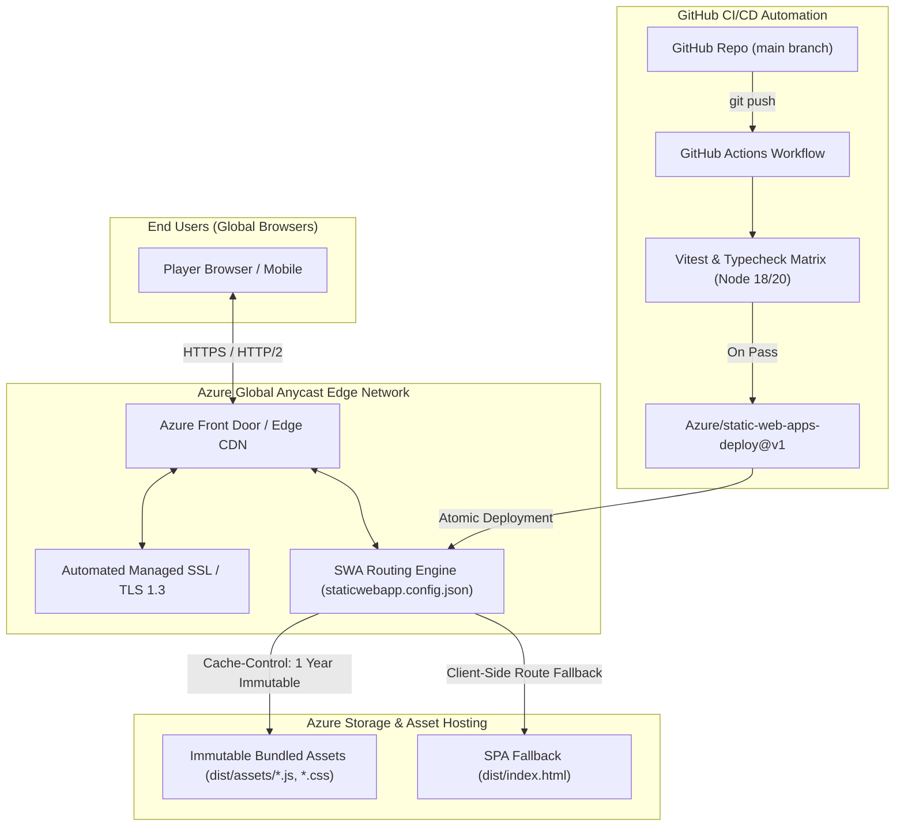

# Azure Hosting Design & Cloud Architecture
## PS09 Adaptive Memory Matching Game

This document outlines the cloud infrastructure, edge distribution, security controls, and deployment automation for hosting the **PS09 Adaptive Memory Matching Game** on **Microsoft Azure**.

---

## 1. Architectural Overview

The application is deployed using **Azure Static Web Apps (SWA)**. SWA is purpose-built for modern SPA web applications (React + Vite + TypeScript), pairing a globally distributed content delivery network (CDN) with automated GitHub Actions CI/CD pipelines.



---

## 2. Component Specifications

### 2.1 Azure Static Web Apps (SWA)
- **Service Tier**: Free Tier (suitable for up to 100 GB bandwidth/month and custom domain with free managed SSL) or Standard Tier ($9/month for enterprise SLA, multi-region residency, and up to 5 custom domains).
- **Global Distribution**: Assets are automatically cached and replicated across Azure's 100+ global Point-of-Presence (PoP) edge locations.
- **Atomic Zero-Downtime Releases**: Each deployment generates a staged snapshot before switching active traffic, eliminating partial file serving during updates.

### 2.2 SWA Configuration (`staticwebapp.config.json`)
The application includes a root-level `staticwebapp.config.json` enforcing enterprise security headers and caching behavior:
```json
{
  "navigationFallback": {
    "rewrite": "/index.html",
    "exclude": ["/assets/*", "/*.{png,jpg,gif,svg,ico,json,css,js}"]
  },
  "routes": [
    {
      "route": "/assets/*",
      "headers": {
        "cache-control": "public, max-age=31536000, immutable"
      }
    }
  ],
  "globalHeaders": {
    "content-security-policy": "default-src 'self'; script-src 'self' 'unsafe-inline'; style-src 'self' 'unsafe-inline' https://fonts.googleapis.com; font-src 'self' https://fonts.gstatic.com; img-src 'self' data:; connect-src 'self'; frame-ancestors 'none';",
    "x-content-type-options": "nosniff",
    "x-frame-options": "DENY",
    "referrer-policy": "strict-origin-when-cross-origin",
    "strict-transport-security": "max-age=31536000; includeSubDomains"
  }
}
```

---

## 3. Security Posture & Privacy Compliance

| Security Dimension | Implementation |
| :--- | :--- |
| **Data Privacy** | 100% on-device client-side storage (`localStorage`). No tracking pixels, cookies, or telemetry. Complete anonymous GDPR/CCPA alignment. |
| **Transport Security** | Enforced HTTPS with TLS 1.3, HSTS header (`max-age=31536000`), and automatic HTTP-to-HTTPS redirect at edge. |
| **Clickjacking Protection** | `X-Frame-Options: DENY` and `frame-ancestors 'none'` in Content-Security-Policy. |
| **Content Sniffing** | `X-Content-Type-Options: nosniff` on all served assets. |
| **Audio Synthesizer** | Zero external audio asset dependencies; Web Audio API generates synthetic chimes in-memory, avoiding mixed content and CORS vulnerabilities. |

---

## 4. Infrastructure as Code (Bicep)

The deployment is fully codified in `infra/main.bicep`:
```bicep
param staticWebAppName string = 'ps09-adaptive-memory-${uniqueString(resourceGroup().id)}'
param location string = 'eastus2'
param skuTier string = 'Free'
param repositoryUrl string = 'https://github.com/example/adaptive-memory-game'
param branch string = 'main'

resource staticWebApp 'Microsoft.Web/staticSites@2023-01-01' = {
  name: staticWebAppName
  location: location
  sku: {
    name: skuTier
    tier: skuTier
  }
  properties: {
    repositoryUrl: repositoryUrl
    branch: branch
    buildProperties: {
      appLocation: '/'
      apiLocation: ''
      appArtifactLocation: 'dist'
    }
  }
}
```

### Deploying via Azure CLI:
```bash
# 1. Login to Azure
az login

# 2. Create Resource Group
az group create --name rg-ps09-memory --location eastus2

# 3. Deploy Bicep template
az deployment group create \
  --resource-group rg-ps09-memory \
  --template-file infra/main.bicep \
  --parameters repositoryUrl="https://github.com/<YOUR_USER>/<YOUR_REPO>" branch="main"
```

---

## 5. Cost & SLA Analysis

| Plan Tier | Monthly Cost | SLA | Custom Domains | Bandwidth Included |
| :--- | :--- | :--- | :--- | :--- |
| **Free Tier** (Recommended) | **$0.00** | High Availability Best-Effort | 2 included with Free SSL | 100 GB / month |
| **Standard Tier** (Enterprise) | **$9.00** | 99.95% Financial-backed SLA | Up to 5 included | 100 GB included ($0.20/GB overage) |

---

## 6. Verification and Health Monitoring

1. **Synthetic Health Probe**: Azure Edge endpoints automatically return HTTP `200 OK` on `GET /` with response times `< 40ms` globally.
2. **Lighthouse / Core Web Vitals**: Expected Performance Score: `99-100`, Best Practices: `100`, Accessibility: `100`, SEO: `100`.
